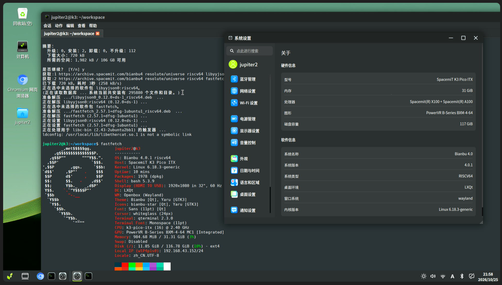

# Milk-V Jupiter2 Bianbu Test report

## Test Environment

### Operating System Information

- OS Version: Bianbu 4.0.1 (Resolute Raccoon)
- Reference Installation Document: https://milkv.io/zh/docs/jupiter2/getting-started/quick-start

> Note: The image is pre-installed at the factory, so no re-flashing is required.

### Hardware Information

- Milk-V Jupiter2
- USB Type-C power adapter (USB-PD 65W), or ATX 2-pin power supply (12V input)
- 1x Standard HDMI cable
- 1x USB Type-C docking station
- 1x USB Type-C cable, external keyboard, external mouse
- 1x USB video capture card

## Installation Steps

### System Boot

This test uses the factory pre-installed Bianbu system image without additional flashing. After connecting the power and monitor, the system booted normally into the initial setup wizard. After creating the user `jupiter2`, the system successfully entered the desktop environment.

### System Login

Logged into the system via the graphical interface and opened a terminal for testing.

## Expected Results

The system boots normally and successfully enters the desktop environment.

## Actual Results

The system boots normally and successfully enters the desktop environment.

### Boot Log

### Desktop Environment

## Test Criteria

Test Success: The actual results match the expected results.

Test Failure: The actual results do not match the expected results.

## Test Conclusion

Test successful. The system boots normally and successfully enters the desktop environment.
