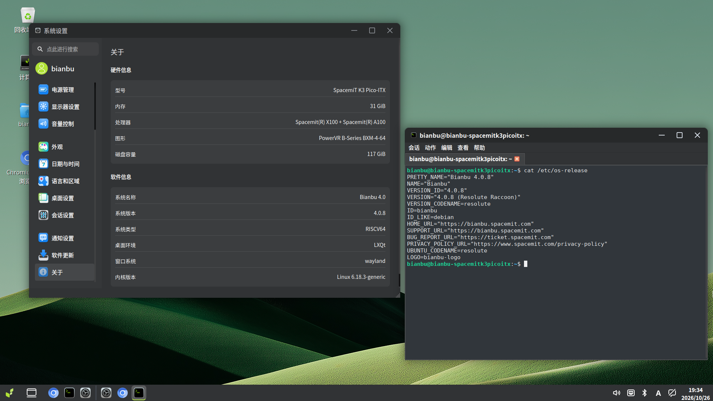

# Bianbu SpacemiT K3 Pico-ITX 测试报告

## 测试环境

### 系统信息

- 系统版本：Bianbu 4.0.8
- 下载链接：https://www.spacemit.com/community/resources-download/Images%20Collects/K3/Bianbu
- 镜像文件名：`Bianbu-LXQt-K3-v4.0.8-20261016130312.tar.gz`
- 参考安装文档：[K3 Pico-ITX 用户使用指南](https://www.spacemit.com/community/document/info?lang=zh&nodepath=ecohardware/k3_series/k3_pico/pico_user_guide.md)、[刷机工具使用手册](https://www.spacemit.com/community/document/info?lang=zh&nodepath=tools/user_guide/flasher_user_guide.md)

### 硬件信息

- SpacemiT K3 Pico-ITX
- 电源适配器
- USB 转 TTL 串口调试器
- 支持数据传输的 Type-C 线缆（烧录用）
- 显示器、显示连接线

## 安装步骤

### 准备镜像与工具

### 刷写镜像（Type-C）

1. 将开发板关机并断电，按住 **FDL** 烧录按键。
2. 接通全功能 Type-C 或 ATX 电源，再松开 FDL，进入烧录模式。若开发板已经上电，则按住 FDL、短按 **RST** 复位键，再松开 FDL。
3. 使用 Type-C 数据线，将开发板的 **DRD Type-C 烧录口**连接到上位机。
4. 使用 Titan 或 fastboot，按照[刷机工具使用手册](https://www.spacemit.com/community/document/info?lang=zh&nodepath=tools/user_guide/flasher_user_guide.md)及 K3 镜像包说明执行烧录，等待工具报告完成。
5. 烧录完成后退出烧录模式，正常重启开发板，检查串口启动信息及桌面显示。

DRD Type-C 烧录口不能向板内供电，烧录期间须通过其他供电口保持供电。Type-C 线缆必须支持数据传输。

### 登录系统

通过串口登录系统。

默认用户名： `root`
默认密码： `bianbu`

## 预期结果

系统正常启动，能够通过串口或图形界面登录。

## 实际结果

系统正常启动，成功通过串口及图形界面登录。

### 启动信息

```log
Bianbu 4.0.8 k3 ttyS0
k3 login: root
密码：
Welcome to Bianbu 4.0.8 (GNU/Linux 6.18.3-generic riscv64)

 * Documentation:  https://bianbu.spacemit.com
 * Support:        https://ticket.spacemit.com


The programs included with the Bianbu system are free software;
the exact distribution terms for each program are described in the
individual files in /usr/share/doc/*/copyright.

Bianbu comes with ABSOLUTELY NO WARRANTY, to the extent permitted by
applicable law.

root@k3:~# cat /etc/os-release
PRETTY_NAME="Bianbu 4.0.8"
NAME="Bianbu"
VERSION_ID="4.0.8"
VERSION="4.0.8 (Resolute Raccoon)"
VERSION_CODENAME=resolute
ID=bianbu
ID_LIKE=debian
HOME_URL="https://bianbu.spacemit.com"
SUPPORT_URL="https://bianbu.spacemit.com"
BUG_REPORT_URL="https://ticket.spacemit.com"
PRIVACY_POLICY_URL="https://www.spacemit.com/privacy-policy"
UBUNTU_CODENAME=resolute
LOGO=bianbu-logo
root@k3:~# uname -a
Linux k3 6.18.3-generic #1.0.10.4 SMP PREEMPT_DYNAMIC Fri Oct 16 12:04:02 CST 2026 riscv64 GNU/Linux
root@k3:~# cat /proc/cpuinfo
processor       : 0
hart            : 0
model name      : Spacemit(R) X100
isa             : rv64imafdcvh_zicbom_zicbop_zicboz_zicntr_zicond_zicsr_zifencei_zihintntl_zihintpause_zihpm_zimop_zaamo_zalrsc_zawrs_zfa_zfbfmin_zfh_zfhmin_zca_zcb_zcd_zcmop_zba_zbb_zbc_zbs_zkt_zvbb_zvbc_zve32f_zve32x_zve64d_zve64f_zve64x_zvfbfmin_zvfbfwma_zvfh_zvfhmin_zvkb_zvkg_zvkned_zvknha_zvknhb_zvksed_zvksh_zvkt_smaia_smstateen_ssaia_sscofpmf_ssnpm_sstc_svade_svinval_svnapot_svpbmt_sdtrig
mmu             : sv39
uarch           : spacemit,x100
mvendorid       : 0x710
marchid         : 0x8000000058000002
mimpid          : 0x33d8a600
hart isa        : rv64imafdcvh_zicbom_zicbop_zicboz_zicntr_zicond_zicsr_zifencei_zihintntl_zihintpause_zihpm_zimop_zaamo_zalrsc_zawrs_zfa_zfbfmin_zfh_zfhmin_zca_zcb_zcd_zcmop_zba_zbb_zbc_zbs_zkt_zvbb_zvbc_zve32f_zve32x_zve64d_zve64f_zve64x_zvfbfmin_zvfbfwma_zvfh_zvfhmin_zvkb_zvkg_zvkned_zvknha_zvknhb_zvksed_zvksh_zvkt_smaia_smstateen_ssaia_sscofpmf_ssnpm_sstc_svade_svinval_svnapot_svpbmt_sdtrig

processor       : 1
hart            : 1
model name      : Spacemit(R) X100
isa             : rv64imafdcvh_zicbom_zicbop_zicboz_zicntr_zicond_zicsr_zifencei_zihintntl_zihintpause_zihpm_zimop_zaamo_zalrsc_zawrs_zfa_zfbfmin_zfh_zfhmin_zca_zcb_zcd_zcmop_zba_zbb_zbc_zbs_zkt_zvbb_zvbc_zve32f_zve32x_zve64d_zve64f_zve64x_zvfbfmin_zvfbfwma_zvfh_zvfhmin_zvkb_zvkg_zvkned_zvknha_zvknhb_zvksed_zvksh_zvkt_smaia_smstateen_ssaia_sscofpmf_ssnpm_sstc_svade_svinval_svnapot_svpbmt_sdtrig
mmu             : sv39
uarch           : spacemit,x100
mvendorid       : 0x710
marchid         : 0x8000000058000002
mimpid          : 0x33d8a600
hart isa        : rv64imafdcvh_zicbom_zicbop_zicboz_zicntr_zicond_zicsr_zifencei_zihintntl_zihintpause_zihpm_zimop_zaamo_zalrsc_zawrs_zfa_zfbfmin_zfh_zfhmin_zca_zcb_zcd_zcmop_zba_zbb_zbc_zbs_zkt_zvbb_zvbc_zve32f_zve32x_zve64d_zve64f_zve64x_zvfbfmin_zvfbfwma_zvfh_zvfhmin_zvkb_zvkg_zvkned_zvknha_zvknhb_zvksed_zvksh_zvkt_smaia_smstateen_ssaia_sscofpmf_ssnpm_sstc_svade_svinval_svnapot_svpbmt_sdtrig

processor       : 2
hart            : 2
model name      : Spacemit(R) X100
isa             : rv64imafdcvh_zicbom_zicbop_zicboz_zicntr_zicond_zicsr_zifencei_zihintntl_zihintpause_zihpm_zimop_zaamo_zalrsc_zawrs_zfa_zfbfmin_zfh_zfhmin_zca_zcb_zcd_zcmop_zba_zbb_zbc_zbs_zkt_zvbb_zvbc_zve32f_zve32x_zve64d_zve64f_zve64x_zvfbfmin_zvfbfwma_zvfh_zvfhmin_zvkb_zvkg_zvkned_zvknha_zvknhb_zvksed_zvksh_zvkt_smaia_smstateen_ssaia_sscofpmf_ssnpm_sstc_svade_svinval_svnapot_svpbmt_sdtrig
mmu             : sv39
uarch           : spacemit,x100
mvendorid       : 0x710
marchid         : 0x8000000058000002
mimpid          : 0x33d8a600
hart isa        : rv64imafdcvh_zicbom_zicbop_zicboz_zicntr_zicond_zicsr_zifencei_zihintntl_zihintpause_zihpm_zimop_zaamo_zalrsc_zawrs_zfa_zfbfmin_zfh_zfhmin_zca_zcb_zcd_zcmop_zba_zbb_zbc_zbs_zkt_zvbb_zvbc_zve32f_zve32x_zve64d_zve64f_zve64x_zvfbfmin_zvfbfwma_zvfh_zvfhmin_zvkb_zvkg_zvkned_zvknha_zvknhb_zvksed_zvksh_zvkt_smaia_smstateen_ssaia_sscofpmf_ssnpm_sstc_svade_svinval_svnapot_svpbmt_sdtrig

processor       : 3
hart            : 3
model name      : Spacemit(R) X100
isa             : rv64imafdcvh_zicbom_zicbop_zicboz_zicntr_zicond_zicsr_zifencei_zihintntl_zihintpause_zihpm_zimop_zaamo_zalrsc_zawrs_zfa_zfbfmin_zfh_zfhmin_zca_zcb_zcd_zcmop_zba_zbb_zbc_zbs_zkt_zvbb_zvbc_zve32f_zve32x_zve64d_zve64f_zve64x_zvfbfmin_zvfbfwma_zvfh_zvfhmin_zvkb_zvkg_zvkned_zvknha_zvknhb_zvksed_zvksh_zvkt_smaia_smstateen_ssaia_sscofpmf_ssnpm_sstc_svade_svinval_svnapot_svpbmt_sdtrig
mmu             : sv39
uarch           : spacemit,x100
mvendorid       : 0x710
marchid         : 0x8000000058000002
mimpid          : 0x33d8a600
hart isa        : rv64imafdcvh_zicbom_zicbop_zicboz_zicntr_zicond_zicsr_zifencei_zihintntl_zihintpause_zihpm_zimop_zaamo_zalrsc_zawrs_zfa_zfbfmin_zfh_zfhmin_zca_zcb_zcd_zcmop_zba_zbb_zbc_zbs_zkt_zvbb_zvbc_zve32f_zve32x_zve64d_zve64f_zve64x_zvfbfmin_zvfbfwma_zvfh_zvfhmin_zvkb_zvkg_zvkned_zvknha_zvknhb_zvksed_zvksh_zvkt_smaia_smstateen_ssaia_sscofpmf_ssnpm_sstc_svade_svinval_svnapot_svpbmt_sdtrig

processor       : 4
hart            : 4
model name      : Spacemit(R) X100
isa             : rv64imafdcvh_zicbom_zicbop_zicboz_zicntr_zicond_zicsr_zifencei_zihintntl_zihintpause_zihpm_zimop_zaamo_zalrsc_zawrs_zfa_zfbfmin_zfh_zfhmin_zca_zcb_zcd_zcmop_zba_zbb_zbc_zbs_zkt_zvbb_zvbc_zve32f_zve32x_zve64d_zve64f_zve64x_zvfbfmin_zvfbfwma_zvfh_zvfhmin_zvkb_zvkg_zvkned_zvknha_zvknhb_zvksed_zvksh_zvkt_smaia_smstateen_ssaia_sscofpmf_ssnpm_sstc_svade_svinval_svnapot_svpbmt_sdtrig
mmu             : sv39
uarch           : spacemit,x100
mvendorid       : 0x710
marchid         : 0x8000000058000002
mimpid          : 0x33d8a600
hart isa        : rv64imafdcvh_zicbom_zicbop_zicboz_zicntr_zicond_zicsr_zifencei_zihintntl_zihintpause_zihpm_zimop_zaamo_zalrsc_zawrs_zfa_zfbfmin_zfh_zfhmin_zca_zcb_zcd_zcmop_zba_zbb_zbc_zbs_zkt_zvbb_zvbc_zve32f_zve32x_zve64d_zve64f_zve64x_zvfbfmin_zvfbfwma_zvfh_zvfhmin_zvkb_zvkg_zvkned_zvknha_zvknhb_zvksed_zvksh_zvkt_smaia_smstateen_ssaia_sscofpmf_ssnpm_sstc_svade_svinval_svnapot_svpbmt_sdtrig

processor       : 5
hart            : 5
model name      : Spacemit(R) X100
isa             : rv64imafdcvh_zicbom_zicbop_zicboz_zicntr_zicond_zicsr_zifencei_zihintntl_zihintpause_zihpm_zimop_zaamo_zalrsc_zawrs_zfa_zfbfmin_zfh_zfhmin_zca_zcb_zcd_zcmop_zba_zbb_zbc_zbs_zkt_zvbb_zvbc_zve32f_zve32x_zve64d_zve64f_zve64x_zvfbfmin_zvfbfwma_zvfh_zvfhmin_zvkb_zvkg_zvkned_zvknha_zvknhb_zvksed_zvksh_zvkt_smaia_smstateen_ssaia_sscofpmf_ssnpm_sstc_svade_svinval_svnapot_svpbmt_sdtrig
mmu             : sv39
uarch           : spacemit,x100
mvendorid       : 0x710
marchid         : 0x8000000058000002
mimpid          : 0x33d8a600
hart isa        : rv64imafdcvh_zicbom_zicbop_zicboz_zicntr_zicond_zicsr_zifencei_zihintntl_zihintpause_zihpm_zimop_zaamo_zalrsc_zawrs_zfa_zfbfmin_zfh_zfhmin_zca_zcb_zcd_zcmop_zba_zbb_zbc_zbs_zkt_zvbb_zvbc_zve32f_zve32x_zve64d_zve64f_zve64x_zvfbfmin_zvfbfwma_zvfh_zvfhmin_zvkb_zvkg_zvkned_zvknha_zvknhb_zvksed_zvksh_zvkt_smaia_smstateen_ssaia_sscofpmf_ssnpm_sstc_svade_svinval_svnapot_svpbmt_sdtrig

processor       : 6
hart            : 6
model name      : Spacemit(R) X100
isa             : rv64imafdcvh_zicbom_zicbop_zicboz_zicntr_zicond_zicsr_zifencei_zihintntl_zihintpause_zihpm_zimop_zaamo_zalrsc_zawrs_zfa_zfbfmin_zfh_zfhmin_zca_zcb_zcd_zcmop_zba_zbb_zbc_zbs_zkt_zvbb_zvbc_zve32f_zve32x_zve64d_zve64f_zve64x_zvfbfmin_zvfbfwma_zvfh_zvfhmin_zvkb_zvkg_zvkned_zvknha_zvknhb_zvksed_zvksh_zvkt_smaia_smstateen_ssaia_sscofpmf_ssnpm_sstc_svade_svinval_svnapot_svpbmt_sdtrig
mmu             : sv39
uarch           : spacemit,x100
mvendorid       : 0x710
marchid         : 0x8000000058000002
mimpid          : 0x33d8a600
hart isa        : rv64imafdcvh_zicbom_zicbop_zicboz_zicntr_zicond_zicsr_zifencei_zihintntl_zihintpause_zihpm_zimop_zaamo_zalrsc_zawrs_zfa_zfbfmin_zfh_zfhmin_zca_zcb_zcd_zcmop_zba_zbb_zbc_zbs_zkt_zvbb_zvbc_zve32f_zve32x_zve64d_zve64f_zve64x_zvfbfmin_zvfbfwma_zvfh_zvfhmin_zvkb_zvkg_zvkned_zvknha_zvknhb_zvksed_zvksh_zvkt_smaia_smstateen_ssaia_sscofpmf_ssnpm_sstc_svade_svinval_svnapot_svpbmt_sdtrig

processor       : 7
hart            : 7
model name      : Spacemit(R) X100
isa             : rv64imafdcvh_zicbom_zicbop_zicboz_zicntr_zicond_zicsr_zifencei_zihintntl_zihintpause_zihpm_zimop_zaamo_zalrsc_zawrs_zfa_zfbfmin_zfh_zfhmin_zca_zcb_zcd_zcmop_zba_zbb_zbc_zbs_zkt_zvbb_zvbc_zve32f_zve32x_zve64d_zve64f_zve64x_zvfbfmin_zvfbfwma_zvfh_zvfhmin_zvkb_zvkg_zvkned_zvknha_zvknhb_zvksed_zvksh_zvkt_smaia_smstateen_ssaia_sscofpmf_ssnpm_sstc_svade_svinval_svnapot_svpbmt_sdtrig
mmu             : sv39
uarch           : spacemit,x100
mvendorid       : 0x710
marchid         : 0x8000000058000002
mimpid          : 0x33d8a600
hart isa        : rv64imafdcvh_zicbom_zicbop_zicboz_zicntr_zicond_zicsr_zifencei_zihintntl_zihintpause_zihpm_zimop_zaamo_zalrsc_zawrs_zfa_zfbfmin_zfh_zfhmin_zca_zcb_zcd_zcmop_zba_zbb_zbc_zbs_zkt_zvbb_zvbc_zve32f_zve32x_zve64d_zve64f_zve64x_zvfbfmin_zvfbfwma_zvfh_zvfhmin_zvkb_zvkg_zvkned_zvknha_zvknhb_zvksed_zvksh_zvkt_smaia_smstateen_ssaia_sscofpmf_ssnpm_sstc_svade_svinval_svnapot_svpbmt_sdtrig

processor       : 8
hart            : 8
model name      : Spacemit(R) A100
isa             : rv64imafdcvh_zicbom_zicbop_zicboz_zicntr_zicond_zicsr_zifencei_zihintntl_zihintpause_zihpm_zimop_zaamo_zalrsc_zawrs_zfa_zfbfmin_zfh_zfhmin_zca_zcb_zcd_zcmop_zba_zbb_zbc_zbs_zkt_zvbb_zvbc_zve32f_zve32x_zve64d_zve64f_zve64x_zvfbfmin_zvfbfwma_zvfh_zvfhmin_zvkb_zvkg_zvkned_zvknha_zvknhb_zvksed_zvksh_zvkt_smaia_smstateen_ssaia_sscofpmf_ssnpm_sstc_svade_svinval_svnapot_svpbmt_sdtrig
mmu             : sv39
uarch           : spacemit,a100
mvendorid       : 0x710
marchid         : 0x8000000041000002
mimpid          : 0x10000000d5686200
hart isa        : rv64imafdcv_zicbom_zicbop_zicboz_zicntr_zicond_zicsr_zifencei_zihintntl_zihintpause_zihpm_zimop_zaamo_zalrsc_zawrs_zfa_zfbfmin_zfh_zfhmin_zca_zcb_zcd_zcmop_zba_zbb_zbc_zbs_zkt_zvbb_zvbc_zve32f_zve32x_zve64d_zve64f_zve64x_zvfbfmin_zvfbfwma_zvfh_zvfhmin_zvkb_zvkg_zvkned_zvknha_zvknhb_zvksed_zvksh_zvkt_smaia_smstateen_ssaia_sscofpmf_ssnpm_sstc_svade_svinval_svnapot_svpbmt_sdtrig

processor       : 9
hart            : 9
model name      : Spacemit(R) A100
isa             : rv64imafdcvh_zicbom_zicbop_zicboz_zicntr_zicond_zicsr_zifencei_zihintntl_zihintpause_zihpm_zimop_zaamo_zalrsc_zawrs_zfa_zfbfmin_zfh_zfhmin_zca_zcb_zcd_zcmop_zba_zbb_zbc_zbs_zkt_zvbb_zvbc_zve32f_zve32x_zve64d_zve64f_zve64x_zvfbfmin_zvfbfwma_zvfh_zvfhmin_zvkb_zvkg_zvkned_zvknha_zvknhb_zvksed_zvksh_zvkt_smaia_smstateen_ssaia_sscofpmf_ssnpm_sstc_svade_svinval_svnapot_svpbmt_sdtrig
mmu             : sv39
uarch           : spacemit,a100
mvendorid       : 0x710
marchid         : 0x8000000041000002
mimpid          : 0x10000000d5686200
hart isa        : rv64imafdcv_zicbom_zicbop_zicboz_zicntr_zicond_zicsr_zifencei_zihintntl_zihintpause_zihpm_zimop_zaamo_zalrsc_zawrs_zfa_zfbfmin_zfh_zfhmin_zca_zcb_zcd_zcmop_zba_zbb_zbc_zbs_zkt_zvbb_zvbc_zve32f_zve32x_zve64d_zve64f_zve64x_zvfbfmin_zvfbfwma_zvfh_zvfhmin_zvkb_zvkg_zvkned_zvknha_zvknhb_zvksed_zvksh_zvkt_smaia_smstateen_ssaia_sscofpmf_ssnpm_sstc_svade_svinval_svnapot_svpbmt_sdtrig

processor       : 10
hart            : 10
model name      : Spacemit(R) A100
isa             : rv64imafdcvh_zicbom_zicbop_zicboz_zicntr_zicond_zicsr_zifencei_zihintntl_zihintpause_zihpm_zimop_zaamo_zalrsc_zawrs_zfa_zfbfmin_zfh_zfhmin_zca_zcb_zcd_zcmop_zba_zbb_zbc_zbs_zkt_zvbb_zvbc_zve32f_zve32x_zve64d_zve64f_zve64x_zvfbfmin_zvfbfwma_zvfh_zvfhmin_zvkb_zvkg_zvkned_zvknha_zvknhb_zvksed_zvksh_zvkt_smaia_smstateen_ssaia_sscofpmf_ssnpm_sstc_svade_svinval_svnapot_svpbmt_sdtrig
mmu             : sv39
uarch           : spacemit,a100
mvendorid       : 0x710
marchid         : 0x8000000041000002
mimpid          : 0x10000000d5686200
hart isa        : rv64imafdcv_zicbom_zicbop_zicboz_zicntr_zicond_zicsr_zifencei_zihintntl_zihintpause_zihpm_zimop_zaamo_zalrsc_zawrs_zfa_zfbfmin_zfh_zfhmin_zca_zcb_zcd_zcmop_zba_zbb_zbc_zbs_zkt_zvbb_zvbc_zve32f_zve32x_zve64d_zve64f_zve64x_zvfbfmin_zvfbfwma_zvfh_zvfhmin_zvkb_zvkg_zvkned_zvknha_zvknhb_zvksed_zvksh_zvkt_smaia_smstateen_ssaia_sscofpmf_ssnpm_sstc_svade_svinval_svnapot_svpbmt_sdtrig

processor       : 11
hart            : 11
model name      : Spacemit(R) A100
isa             : rv64imafdcvh_zicbom_zicbop_zicboz_zicntr_zicond_zicsr_zifencei_zihintntl_zihintpause_zihpm_zimop_zaamo_zalrsc_zawrs_zfa_zfbfmin_zfh_zfhmin_zca_zcb_zcd_zcmop_zba_zbb_zbc_zbs_zkt_zvbb_zvbc_zve32f_zve32x_zve64d_zve64f_zve64x_zvfbfmin_zvfbfwma_zvfh_zvfhmin_zvkb_zvkg_zvkned_zvknha_zvknhb_zvksed_zvksh_zvkt_smaia_smstateen_ssaia_sscofpmf_ssnpm_sstc_svade_svinval_svnapot_svpbmt_sdtrig
mmu             : sv39
uarch           : spacemit,a100
mvendorid       : 0x710
marchid         : 0x8000000041000002
mimpid          : 0x10000000d5686200
hart isa        : rv64imafdcv_zicbom_zicbop_zicboz_zicntr_zicond_zicsr_zifencei_zihintntl_zihintpause_zihpm_zimop_zaamo_zalrsc_zawrs_zfa_zfbfmin_zfh_zfhmin_zca_zcb_zcd_zcmop_zba_zbb_zbc_zbs_zkt_zvbb_zvbc_zve32f_zve32x_zve64d_zve64f_zve64x_zvfbfmin_zvfbfwma_zvfh_zvfhmin_zvkb_zvkg_zvkned_zvknha_zvknhb_zvksed_zvksh_zvkt_smaia_smstateen_ssaia_sscofpmf_ssnpm_sstc_svade_svinval_svnapot_svpbmt_sdtrig

processor       : 12
hart            : 12
model name      : Spacemit(R) A100
isa             : rv64imafdcvh_zicbom_zicbop_zicboz_zicntr_zicond_zicsr_zifencei_zihintntl_zihintpause_zihpm_zimop_zaamo_zalrsc_zawrs_zfa_zfbfmin_zfh_zfhmin_zca_zcb_zcd_zcmop_zba_zbb_zbc_zbs_zkt_zvbb_zvbc_zve32f_zve32x_zve64d_zve64f_zve64x_zvfbfmin_zvfbfwma_zvfh_zvfhmin_zvkb_zvkg_zvkned_zvknha_zvknhb_zvksed_zvksh_zvkt_smaia_smstateen_ssaia_sscofpmf_ssnpm_sstc_svade_svinval_svnapot_svpbmt_sdtrig
mmu             : sv39
uarch           : spacemit,a100
mvendorid       : 0x710
marchid         : 0x8000000041000002
mimpid          : 0x10000000d5686200
hart isa        : rv64imafdcv_zicbom_zicbop_zicboz_zicntr_zicond_zicsr_zifencei_zihintntl_zihintpause_zihpm_zimop_zaamo_zalrsc_zawrs_zfa_zfbfmin_zfh_zfhmin_zca_zcb_zcd_zcmop_zba_zbb_zbc_zbs_zkt_zvbb_zvbc_zve32f_zve32x_zve64d_zve64f_zve64x_zvfbfmin_zvfbfwma_zvfh_zvfhmin_zvkb_zvkg_zvkned_zvknha_zvknhb_zvksed_zvksh_zvkt_smaia_smstateen_ssaia_sscofpmf_ssnpm_sstc_svade_svinval_svnapot_svpbmt_sdtrig

processor       : 13
hart            : 13
model name      : Spacemit(R) A100
isa             : rv64imafdcvh_zicbom_zicbop_zicboz_zicntr_zicond_zicsr_zifencei_zihintntl_zihintpause_zihpm_zimop_zaamo_zalrsc_zawrs_zfa_zfbfmin_zfh_zfhmin_zca_zcb_zcd_zcmop_zba_zbb_zbc_zbs_zkt_zvbb_zvbc_zve32f_zve32x_zve64d_zve64f_zve64x_zvfbfmin_zvfbfwma_zvfh_zvfhmin_zvkb_zvkg_zvkned_zvknha_zvknhb_zvksed_zvksh_zvkt_smaia_smstateen_ssaia_sscofpmf_ssnpm_sstc_svade_svinval_svnapot_svpbmt_sdtrig
mmu             : sv39
uarch           : spacemit,a100
mvendorid       : 0x710
marchid         : 0x8000000041000002
mimpid          : 0x10000000d5686200
hart isa        : rv64imafdcv_zicbom_zicbop_zicboz_zicntr_zicond_zicsr_zifencei_zihintntl_zihintpause_zihpm_zimop_zaamo_zalrsc_zawrs_zfa_zfbfmin_zfh_zfhmin_zca_zcb_zcd_zcmop_zba_zbb_zbc_zbs_zkt_zvbb_zvbc_zve32f_zve32x_zve64d_zve64f_zve64x_zvfbfmin_zvfbfwma_zvfh_zvfhmin_zvkb_zvkg_zvkned_zvknha_zvknhb_zvksed_zvksh_zvkt_smaia_smstateen_ssaia_sscofpmf_ssnpm_sstc_svade_svinval_svnapot_svpbmt_sdtrig

processor       : 14
hart            : 14
model name      : Spacemit(R) A100
isa             : rv64imafdcvh_zicbom_zicbop_zicboz_zicntr_zicond_zicsr_zifencei_zihintntl_zihintpause_zihpm_zimop_zaamo_zalrsc_zawrs_zfa_zfbfmin_zfh_zfhmin_zca_zcb_zcd_zcmop_zba_zbb_zbc_zbs_zkt_zvbb_zvbc_zve32f_zve32x_zve64d_zve64f_zve64x_zvfbfmin_zvfbfwma_zvfh_zvfhmin_zvkb_zvkg_zvkned_zvknha_zvknhb_zvksed_zvksh_zvkt_smaia_smstateen_ssaia_sscofpmf_ssnpm_sstc_svade_svinval_svnapot_svpbmt_sdtrig
mmu             : sv39
uarch           : spacemit,a100
mvendorid       : 0x710
marchid         : 0x8000000041000002
mimpid          : 0x10000000d5686200
hart isa        : rv64imafdcv_zicbom_zicbop_zicboz_zicntr_zicond_zicsr_zifencei_zihintntl_zihintpause_zihpm_zimop_zaamo_zalrsc_zawrs_zfa_zfbfmin_zfh_zfhmin_zca_zcb_zcd_zcmop_zba_zbb_zbc_zbs_zkt_zvbb_zvbc_zve32f_zve32x_zve64d_zve64f_zve64x_zvfbfmin_zvfbfwma_zvfh_zvfhmin_zvkb_zvkg_zvkned_zvknha_zvknhb_zvksed_zvksh_zvkt_smaia_smstateen_ssaia_sscofpmf_ssnpm_sstc_svade_svinval_svnapot_svpbmt_sdtrig

processor       : 15
hart            : 15
model name      : Spacemit(R) A100
isa             : rv64imafdcvh_zicbom_zicbop_zicboz_zicntr_zicond_zicsr_zifencei_zihintntl_zihintpause_zihpm_zimop_zaamo_zalrsc_zawrs_zfa_zfbfmin_zfh_zfhmin_zca_zcb_zcd_zcmop_zba_zbb_zbc_zbs_zkt_zvbb_zvbc_zve32f_zve32x_zve64d_zve64f_zve64x_zvfbfmin_zvfbfwma_zvfh_zvfhmin_zvkb_zvkg_zvkned_zvknha_zvknhb_zvksed_zvksh_zvkt_smaia_smstateen_ssaia_sscofpmf_ssnpm_sstc_svade_svinval_svnapot_svpbmt_sdtrig
mmu             : sv39
uarch           : spacemit,a100
mvendorid       : 0x710
marchid         : 0x8000000041000002
mimpid          : 0x10000000d5686200
hart isa        : rv64imafdcv_zicbom_zicbop_zicboz_zicntr_zicond_zicsr_zifencei_zihintntl_zihintpause_zihpm_zimop_zaamo_zalrsc_zawrs_zfa_zfbfmin_zfh_zfhmin_zca_zcb_zcd_zcmop_zba_zbb_zbc_zbs_zkt_zvbb_zvbc_zve32f_zve32x_zve64d_zve64f_zve64x_zvfbfmin_zvfbfwma_zvfh_zvfhmin_zvkb_zvkg_zvkned_zvknha_zvknhb_zvksed_zvksh_zvkt_smaia_smstateen_ssaia_sscofpmf_ssnpm_sstc_svade_svinval_svnapot_svpbmt_sdtrig

root@k3:~# lscpu
架构：                       riscv64
  字节序：                   Little Endian
CPU:                         16
  在线 CPU 列表：            0-15
型号名称：                   Spacemit(R) A100
  每个核的线程数：           0
  每个座的核数：             0
  座：                       0
  Frequency boost:           禁用
型号名称：                   Spacemit(R) X100
  每个核的线程数：           0
  每个座的核数：             0
  座：                       0
型号名称：                   spacemit,a100
  CPU 系列：                 0x8000000041000002
  型号：                     0x10000000d5686200
  每个核的线程数：           1
  每个座的核数：             8
  座：                       1
  CPU(s) scaling MHz:        100%
  CPU 最大 MHz：             1800.0000
  CPU 最小 MHz：             614.4000
型号名称：                   spacemit,x100
  CPU 系列：                 0x8000000058000002
  型号：                     0x33d8a600
  每个核的线程数：           1
  每个座的核数：             8
  座：                       1
  CPU(s) scaling MHz:        93%
  CPU 最大 MHz：             2150.0000
  CPU 最小 MHz：             614.4000
Caches (sum of all):
  L1d:                       768 KiB (16 instances)
  L1i:                       768 KiB (16 instances)
  L2:                        10 MiB (4 instances)
Vulnerabilities:
  Gather data sampling:      Not affected
  Ghostwrite:                Not affected
  Indirect target selection: Not affected
  Itlb multihit:             Not affected
  L1tf:                      Not affected
  Mds:                       Not affected
  Meltdown:                  Not affected
  Mmio stale data:           Not affected
  Old microcode:             Not affected
  Reg file data sampling:    Not affected
  Retbleed:                  Not affected
  Spec rstack overflow:      Not affected
  Spec store bypass:         Not affected
  Spectre v1:                Not affected
  Spectre v2:                Not affected
  Srbds:                     Not affected
  Tsa:                       Not affected
  Tsx async abort:           Not affected
  Vmscape:                   Not affected
root@k3:~# lsblk
NAME      MAJ:MIN RM   SIZE RO TYPE MOUNTPOINTS
sda         8:0    0 119.3G  0 disk
├─sda1      8:1    0   256M  0 part
├─sda2      8:2    0   256M  0 part /boot
└─sda3      8:3    0 118.8G  0 part /
mtdblock0  31:0    0     8M  0 disk
mtdblock1  31:1    0   128K  0 disk
mtdblock2  31:2    0   512K  0 disk
mtdblock3  31:3    0    64K  0 disk
mtdblock4  31:4    0     1M  0 disk
mtdblock5  31:5    0   384K  0 disk
mtdblock6  31:6    0   5.9M  0 disk
root@k3:~# df -h
文件系统        容量  已用  可用 已用% 挂载点
tmpfs           3.2G  1.8M  3.2G    1% /run
/dev/sda3       117G  5.9G  105G    6% /
tmpfs            16G  192K   16G    1% /dev/shm
tmpfs            16G  8.0K   16G    1% /tmp
none            1.0M     0  1.0M    0% /run/credentials/systemd-journald.service
none            1.0M     0  1.0M    0% /run/credentials/systemd-resolved.service
/dev/sda2       224M   60M  146M   30% /boot
tmpfs           3.2G   92K  3.2G    1% /run/user/999
none            1.0M     0  1.0M    0% /run/credentials/serial-getty@ttyS0.service
tmpfs           3.2G   84K  3.2G    1% /run/user/0
root@k3:~#
```

## 桌面环境

该镜像已预装 **LXQt** 桌面环境，连接显示器会以桌面会话自动启动。



## 测试判定标准

测试成功：实际结果与预期结果相符。

测试失败：实际结果与预期结果不符。

## 测试结论

测试成功
